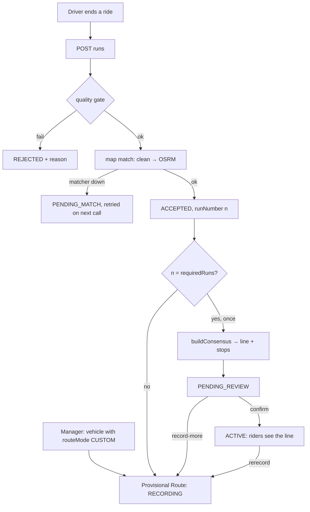

# CUSTOM ROUTES — Pingo Backend

Driver-recorded routes: a manager marks a vehicle "custom", its driver records the first
5 rides, the rides are fitted to roads (OpenStreetMap map matching, no Google) and merged
into one route, and the manager confirms it. Plan: [`CUSTOM_ROUTES_V2_PLAN.md`](../../../CUSTOM_ROUTES_V2_PLAN.md).

**Status:** `SHIPPED` — replaces the v1 feature removed on 2026-08-04 (commit `f4bfff0`). v1 recorded
once and had no way to merge rides or name the result; v2 is built on a different core.
Needs a self-hosted map matcher before real use (see §8).

**Consumed by:** driver-app (records rides — `docs/modules/ROUTE_MANAGEMENT.md`), web-admin
(review + confirm — `docs/modules/CUSTOM_ROUTES.md`), user-app (draws the confirmed line —
`docs/modules/LIVE_MAP.md`).

---

## 1. Purpose

A school/work shuttle does not run a public route, so nobody has its road line. Instead of a
manager drawing one, the driver drives it. The first N rides (default 5) are recording rides; each is
map-matched to the road network, and the ride that agrees most with the others becomes the route.
The hard constraint: **a custom route is visible only to the people it belongs to** (its manager,
its driver, super-admins, and riders enrolled with that driver once it is live) — it must never
leak into public lists, search, planning, stats or the shared path cache.

## 2. API surface

| Method | Path | Auth | Controller fn | Notes |
|---|---|---|---|---|
| `GET` | `/api/driver/custom-routes/current` | `protect` + `requireDriver` | `customRouteController.getCurrent` | `data: null` for a driver not on a custom route. Retries rides stuck `PENDING_MATCH`. |
| `POST` | `/api/driver/custom-routes/runs` | `protect` + `requireDriver` | `customRouteController.submitRun` | Idempotent on `clientRunId`. 201 new / 200 repeat. 409 `NOT_RECORDING`. Quality rejections are a **200/201 with `run.status: REJECTED`**, not an HTTP error. |
| `DELETE` | `/api/driver/custom-routes/runs/:runId` | `protect` + `requireDriver` | `customRouteController.discardRun` | Only the driver's own run, only while `RECORDING`. Renumbers the rest. |
| `GET` | `/api/manager/custom-routes?status=` | `protect` + `requireManager` | `managerCustomRoutesController.listCustomRoutes` | Own routes only; no geometry. |
| `GET` | `/api/manager/custom-routes/count` | `protect` + `requireManager` | `…countPendingReview` | Nav badge: routes waiting on the manager. |
| `GET` | `/api/manager/custom-routes/:routeId` | `protect` + `requireManager` | `…getCustomRoute` | Line, stops, and every accepted ride's matched line. Shows the **candidate** while a live route is being re-recorded. |
| `PATCH` | `/api/manager/custom-routes/:routeId/confirm` | `protect` + `requireManager` | `…confirmCustomRoute` | `PENDING_REVIEW → ACTIVE`. 409 `NOT_PENDING_REVIEW` if repeated. |
| `POST` | `/api/manager/custom-routes/:routeId/record-more` | `protect` + `requireManager` | `…recordMore` | `PENDING_REVIEW → RECORDING`, `requiredRuns += 1..3`. |
| `POST` | `/api/manager/custom-routes/:routeId/rerecord` | `protect` + `requireManager` | `…reRecord` | `ACTIVE → RECORDING`; discards old rides; live line stays. |
| `POST` | `/api/manager/vehicle-accounts` | `protect` + `requireManager` | `managerController.createManagerVehicle` | `routeMode: 'CUSTOM'` (no `routeId`) provisions the route. Later vehicles become a request. |
| `PATCH` | `/api/super-admin/vehicle-requests/:id/review` | `protect` + `requireSuperAdmin` | `superAdminController.reviewVehicleRequest` | Approving a `routeMode: 'CUSTOM'` request creates the route then. |
| `GET` | `/api/routes/:routeId`, `/api/vehicle/routes/:routeId/path`, `/api/vehicle/route/:routeId` | `optionalAuth` | route / geometry / vehicle controllers | A custom route answers only to people it belongs to (§6); everyone else gets 404 / an empty list. |

## 3. Key files (one job each)

| File | Responsibility |
|---|---|
| `src/routes/customRouteRoutes.js` | Driver endpoints; mounted **before** the `/api/driver` catch-all in `server.js`. |
| `src/controllers/customRouteController.js` | Driver side: progress, upload a ride, discard. |
| `src/controllers/managerCustomRoutesController.js` | Manager side: list, review, confirm, record-more, re-record. |
| `src/models/RouteRecordingRun.js` | One ride: raw track, stops, matched line. |
| `src/models/Route.js` | `origin`, `status`, `recording.*` fields (§4). |
| `src/utils/customRoute.js` | Provisional route, quality gate, match-and-accept, building the route, `canViewCustomRoute`. |
| `src/utils/mapMatch/` | `clean.js` (GPS cleaning), `osrm.js` (map matcher adapter), `index.js` (provider switch). |
| `src/utils/routeConsensus.js` | Pure: pick the best ride, cluster stops. |
| `src/utils/geo.js` | Pure geometry: resample, coverage, projection, length. |
| `src/utils/stopArrival.js` | Pure: has the vehicle pulled up to a stop / left it; which rider belongs to which stop. |
| `src/services/stopArrivalNotifier.js` | Per-fix arrival check (cached stops, no DB on the hot path); on an arrival emits `vehicle:arrival`, writes the `Notification`, sends the push. Fed by `socket/liveTracking.js`. |
| `scripts/verify-route-geometry.js` | Development check: simulated noisy rides on a real road, run through the production pipeline and judged against raw OpenStreetMap roads and buildings. |
| `src/utils/roadSnap.js` | Polyline encode/decode, downsample. (Google snap-to-roads removed.) |
| `scripts/migrate-custom-route-status.js` | `PENDING_NAMING` → `RECORDING`/`PENDING_REVIEW`. |

## 4. Data model

| Model | Key fields | Indexes / invariants |
|---|---|---|
| `Route` (custom) | `origin: 'RECORDED'`, `status: RECORDING \| PENDING_REVIEW \| ACTIVE`, `managerId`, `recording.{requiredRuns, acceptedRuns, confidence, warning, builtAt, candidate}`, `pathPolyline`, `stops` | `{managerId, origin, status, isDeleted}`. `routeId` = `CUST-<4 hex of manager>-<6 hex random>` (random, not a count, so two creates cannot collide; retried on duplicate key). Placeholder `routeName/source/destination` = `Recording…` until confirmed. |
| `RouteRecordingRun` | `routeId`, `clientRunId`, `runNumber`, `status: PENDING_MATCH \| ACCEPTED \| REJECTED \| DISCARDED`, `rejectReason`, `points[≤5000]`, `stops[]`, `matched.{polyline, confidence, provider}` | unique `{routeId, clientRunId}` (idempotent upload); `{routeId, status}`. A REJECTED run stores no track. |

`Vehicle.routeId` points at the provisional route from the moment the vehicle exists, so live
tracking and rider enrolment work from the first ride. `recording.candidate` holds a re-recording's
new line until the manager confirms it — a live route is never blanked.

## 5. Request flow

Quality gate (before any matching work): ≥ `CUSTOM_ROUTE_MIN_POINTS` (20) points → else `TOO_FEW_POINTS`;
≥ `CUSTOM_ROUTE_MIN_METERS` (500 m) driven → `TOO_SHORT`; not byte-identical to an earlier ride
(`DUPLICATE`, whole-track fingerprint); start and end within 500 m of the first ride's → else
`NOT_SAME_ROUTE`. After matching, a trace not on any road is `NOT_ON_ROAD`.

Building the route (`routeConsensus.js`): resample each matched ride to 10 m; a ride's score is its mean
agreement (share of points within 25 m of the other, both ways) with the others; only rides that start and
end near the median start/end are eligible (a half-ride cannot win); the highest score is the route — a
real road path, never an average. `warning: 'RUNS_DISAGREE'` if the winner scores < 0.8 or fewer than 3
rides agree with it. Stops: taps clustered within 40 m, kept if ≥ half the rides tapped them, moved onto the
line, ordered along it.

### Stops: naming, freezing, and the arrival alert

- **Naming.** On a recording ride the driver taps *Add stop* where the vehicle is (the GPS position is
  saved on the tap) and is then asked for a name, e.g. "Nimal's house" (`stops[].name`, max 80 chars,
  optional). Taps from all rides are clustered (within 40 m, kept if at least half the rides have it);
  the name most rides gave wins, an unnamed stop becomes `Stop N`. The manager sees these names in the
  review and can rename any stop before confirming (`PATCH …/confirm` body `stops`).
- **Frozen once live.** Stops are taken only from recording rides. When the route is `ACTIVE` the driver
  app shows no *Add stop*, and `POST /runs` answers 409 `NOT_RECORDING`, so a live route's stops change only
  through the manager (re-record, or editing at confirm).
- **Arrival alert.** For an `ACTIVE` custom route, every accepted `driver:location` is checked against
  the route's stops (`utils/stopArrival.js`). *Arrived* = within 80 m of a stop, moving under 5 m/s,
  fix accuracy ≤ 60 m. *Left* = farther than 150 m from it. A stop fires **once per shift**
  (`sessionId`; a reconnect mid-shift keeps the session id). On arrival: `vehicle:arrival` goes to every
  watcher of the vehicle (`forYou: false`), a second `vehicle:arrival` with `forYou: true` goes to the
  rider rooms of the households whose stop it is, a `VEHICLE_ARRIVAL` `Notification` is stored for each
  (`eventId = arrival:<sessionId>:<order>:<riderId>`, unique, so a repeat never pushes twice) and an
  Expo push is sent to the household's devices. See [`REALTIME.md`](REALTIME.md).
- **Which rider belongs to which stop.** The rider's pickup place (the enrolment's `pickupPlaceId`, else the
  rider's `defaultPickupPlaceId`) is matched to the *nearest* stop within 250 m. A rider with no pickup
  place sees the stops and the "shuttle is at a stop" banner but is not pushed for any stop.
- **Cost.** The stops are cached in memory (5 min; invalidated when a route is confirmed or re-recorded;
  a route with no stops is re-checked every 60 s). A fix costs a box test plus a distance for stops
  within ~130 m: 20,000 fixes against 200 stops take ~25 ms. The database is read only when a stop
  fires (enrolments, pickup places) and the work runs after the ack, so it never slows the driver.
- **Not done:** a stop passed without stopping is never announced (nor an "approaching" alert); the
  return direction is not handled; stop names are visible to every parent on the vehicle.

## 6. Authorization & security rules

- Driver endpoints act only on the route of the vehicle assigned to the caller; another driver's
  run id is a 404.
- Manager endpoints scope **every** query by `managerId` and `origin: 'RECORDED'`; another
  manager's route is a **404**, never 403 (ids cannot be probed).
- `canViewCustomRoute(user, route)`: super-admin always; the owning manager; the driver of a vehicle on it;
  a rider only when the route is `ACTIVE` **and** they have an `ACTIVE` `DriverEnrollment` with a driver whose
  vehicle runs it. Used by `getRouteById`, `getRoutePath`, `getVehiclesByRoute`.
- `listableRouteFilter()` (`origin: { $ne: 'RECORDED' }`) keeps custom routes out of `GET /api/routes`,
  `/paginated`, `/api/vehicle/routes`, `/stops`, `/plan` and the stats — **at every status**.
- `getRoutePath` never puts a custom route in `pathCache` (served with no access check) and never calls the
  Google fallback for one.
- A route in `RECORDING`/`PENDING_REVIEW` is not assignable to another vehicle (`getManagerAssignableRoutes`,
  create, update) — except that the vehicle already on it may keep it.
- Confirm/record-more/re-record are state-guarded with a conditional update, so a double click or two tabs
  cannot apply twice.
- Not trusted from the client: point/stop counts and ranges are re-validated and capped (5000 points, 100 stops).

## 7. Side effects

| Effect | Trigger | Detail |
|---|---|---|
| External API | every accepted ride | `utils/mapMatch/osrm.js` → `MAP_MATCH_URL` (`/match/v1/driving`). Sent in windows of at most `MAP_MATCH_MAX_POINTS` (default 90) with shared context at the joins; each window's output is trimmed so the joined line never doubles back. A `TooBig` answer halves the window and the working size is remembered. 2 retries, 15 s timeout. |
| Audit log | confirm, re-record | `ManagerAuditLog` `CUSTOM_ROUTE_CONFIRMED`, `CUSTOM_ROUTE_RERECORD_STARTED` (entityType `ROUTE`). |
| Cache | confirm | `routeGeometryController._pathCache` entry dropped. |
| Notification | — | None. `Notification` supports only riders and drivers; the manager's nav badge polls `GET …/count`. |

## 8. Not visible in the API surface

- **Map matcher.** `MAP_MATCH_PROVIDER=osrm`, `MAP_MATCH_URL` (default: the public OSRM demo server —
  development only: its terms forbid heavy use, it has no uptime promise, and it accepts **at most 10 trace
  points per request** where a self-hosted OSRM takes 100, so a ride takes a few dozen sequential requests there),
  `MAP_MATCH_TIMEOUT_MS`, `MAP_MATCH_MAX_POINTS`. Checked against the real demo server on 2026-11-04 with a noisy
  GPS trace sampled from a real Colombo road: the matched line was 99.9% of the true road's length, 100% on it, and a
  second noisy ride agreed with the first 100%.
  Run your own OSRM/Valhalla with the Sri Lanka OSM extract before real use and point `MAP_MATCH_URL` at it.
  Unreachable matcher ⇒ ride stays `PENDING_MATCH` and is retried; the route can never reach review with an
  unmatched ride and a raw line is never shown to riders.
- Env: `CUSTOM_ROUTE_REQUIRED_RUNS` (5), `CUSTOM_ROUTE_MIN_POINTS` (20), `CUSTOM_ROUTE_MIN_METERS` (500).
  Thresholds in `routeConsensus.js` (25 m cover radius, 150 m endpoint tolerance, 0.8 agreement, 40 m stop
  cluster) are constants — tune on a real five-day sample.
- `scripts/seed-sandbox.js` seeds one custom route in each state (recording 2/5, to review, live), each with
  its own vehicle + driver.
- `scripts/migrate-custom-route-status.js` (dry run by default, `--apply`) maps legacy `PENDING_NAMING`.
- `GOOGLE_ROADS_KEY` is no longer used.

## 9. Known gotchas / regressions

- Approving a vehicle request needs the driver's **email** (existing behaviour of `CREATE_VEHICLE_ACCOUNT`);
  the custom route itself is created at approval, so a rejected request leaves nothing behind.
- All rides are treated as one direction; `pathPolylineReturn` stays empty for a custom route.
- Rides are matched inside the upload request (a long ride is a few sequential matcher calls). If the matcher
  is slow the driver's End-journey waits; the app queues the ride if the request times out.
- Re-recording discards the old rides (`DISCARDED`); they are not recoverable.
- The ride-agreement thresholds are untuned on real GPS.

## 10. Tests covering this module

| Layer | File | What it locks |
|---|---|---|
| Unit | `tests/unit/map-match-clean.test.js` | accuracy drop, teleport drop, stationary collapse, ordering, last fix kept |
| Unit | `tests/unit/map-match-osrm.test.js` | chunk + overlap, stitch, NoMatch, retries → `MatchUnavailable`, recovery |
| Unit | `tests/unit/route-consensus.test.js` | detour loses the vote, half-ride cannot win, `RUNS_DISAGREE`, stop clustering/order, geo helpers |
| Unit | `tests/unit/geo.test.js` | distance, nearest stop, segment/polyline distance |
| Unit | `tests/unit/migrate-custom-route-status.test.js` | legacy status mapping |
| Integration | `tests/integration/custom-routes.test.js` | provisioning (immediate + approval + rejection), driver endpoints, quality gate, idempotency, pending-match retry, build-once on concurrent last rides, `RUNS_DISAGREE`, confirm/record-more/re-record state machine, ownership 404s, assignability, every visibility rule |

## 11. Change protocol

Any change to this module must:
1. Run `npx jest tests/unit tests/integration/custom-routes.test.js` green as a baseline.
2. Implement **route → middleware → controller → model**; keep geometry/ranking in the pure utils.
3. Add/adjust tests for every changed behaviour, **including the authz and visibility failure cases**.
4. Update **this doc**, the [`TESTING_GUIDE.md`](../TESTING_GUIDE.md) rows, and append a [`CHANGES.md`](../CHANGES.md) entry.
5. **A contract change updates the consuming app docs too** (driver-app `ROUTE_MANAGEMENT.md`, web-admin
   `CUSTOM_ROUTES.md`, user-app `LIVE_MAP.md`).
6. A schema/endpoint change updates `scripts/seed-sandbox.js` in the same change.
